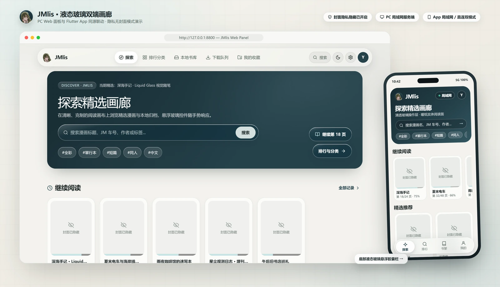

<div align="center">


# JMlis

**顺手、耐看、随时随地都能接着看的双端漫画阅读与管理站**

PC 暖纸阅读面板 · 手机局域网 / 外出直连双模式 · Liquid Glass 液态玻璃浮层 · 一键隐藏封面 · SQLite 进度同步

[**快速上手**](#-三分钟跑起来) · [**PC 与 App 预览**](#-界面预览) · [**技术细节**](#-工程架构与技术细节) · [**下载发行版 (Releases)**](https://github.com/Yalis0910/JMlis/releases) · [**问题反馈 (Issues)**](https://github.com/Yalis0910/JMlis/issues)

<p>
  <a href="https://github.com/Yalis0910/JMlis/releases"></a>
  
  
  
  
  <a href="https://github.com/Yalis0910/JMlis/actions/workflows/build-app.yml"></a>
  <a href="./LICENSE"></a>
</p>

<picture>
  <source media="(prefers-color-scheme: dark)" srcset="assets/screenshots/hero-dark.webp" />
  <source media="(prefers-color-scheme: light)" srcset="assets/screenshots/hero-light.webp" />
  
</picture>

<sub>以上预览由本地构建的 Web 前端与移动端界面规范合图生成，演示全程开启「关闭漫画封面显示」隐私状态，榜单与书名仅作展示用途。</sub>

</div>

> **为什么折腾 JMlis？**
>
> 在浏览器里直接翻漫画经常遇到两件烦心事：要么页面杂、加载慢，条漫反混淆图片刷半天还容易裂图；要么在电脑上下好想躺床上用手机继续看，进度却不同步，出了门连不上家里的服务又彻底看不了。
>
> **JMlis** 就是为了把这两件事一次理顺：电脑上跑一个安静的本地服务端 + 暖纸风 Web 面板，手机上装一个能自动切换**「在家连内网 / 出门切直连」**的 Flutter App，顺便把**封面隐私隐藏**和**阅读进度同步**也一并做了。

---

## 用起来怎么样（核心亮点）

- **操作层用玻璃，看漫画留在暖纸上**：没有花哨乱闪的特效，白天的 **暖纸白 (`#F3F2ED`)** 和晚上的 **深海夜读 (`#0E1619`)** 都是专门调过的低刺激底色，只有顶栏、搜框、悬浮按钮这些控件层才用 Liquid Glass 液态玻璃。
- **在家飞快，出门不断档**：手机连上家里 Wi-Fi 自动走电脑局域网服务端，直接读硬盘里的本地书库和双上限缓存；出门切流量后自动转为手机端直连解密，章节可以离线缓存在手机上，回家连上内网自动把进度合并同步回来。
- **公共场合不社死**：Web 和 App 都内置了**「显示漫画封面」开关**。关掉以后，首页推荐、继续阅读、排行榜、搜索结果和详情页背景里的封面图会统一隐藏为安全占位，只保留标题、车号和分类标签。
- **桌面端顺手得像本地软件**：顶部居中悬浮胶囊 Dock 带弹簧滑动指示器，随时按 `Ctrl + K`（或 `⌘ + K`）就能呼出着色玻璃搜索框；看漫画支持**纵向条漫、单页左→右、单页日漫右→左、双页跨页**四种模式。
- **下载好的目录与 `.zip` 直接看**：服务端会自动扫描下载目录（普通文件夹和 `.zip` 归档都认），局域网内打开即读；还支持可选的局域网 PIN 码锁，不怕同一 Wi-Fi 下被误点进去。
- **不卡顿也不挤爆硬盘**：图片代理、条带反混淆和封面拉取都在后台线程池跑，磁盘缓存按「文件数 + 总体积」双上限做 LRU 淘汰；手机端直连的条带还原也放在 Dart Isolate 里异步处理。

---

## 界面预览

### 1. PC 端：暖纸实体画布 × 着色玻璃浮层

<p align="center">
  
</p>

- **顶部悬浮胶囊导航栏**：集成在「探索 / 排行分类 / 本地书库 / 下载队列 / 我的收藏」五个高频入口之间，切换时有阻尼弹簧滑动指示器。
- **`Ctrl + K` 着色玻璃全局检索**：不用跳页面，在任何角落按下快捷键就能直接搜车号、作者、标签或 `+包含 -排除` 组合关键词，还保留最近搜索历史。
- **Chromium 实时边缘折光**：在 Chrome / Edge 等 Chromium 内核浏览器里会启用基于解析圆角法线的 SVG `<feDisplacementMap>` 边缘折光与 `1px` 定向高光；Firefox / Safari 等浏览器会自动平滑降级为一致的磨砂质感。
- **四模式沉浸阅读器**：上下悬浮双胶囊 HUD 脱离屏幕边缘，支持并发预加载、单页失败原地重试、缩略图抽屉、章节正倒序切换和键盘翻页。

### 2. App 端：在家连内网，出门切直连

<p align="center">
  
</p>

- **局域网模式（LAN Server）**：连接家里电脑的 `server/`，右上角亮起绿色 `● 局域网` 状态胶囊，直接读取本地已下载书库、控制电脑端后台下载任务，并复用服务端磁盘缓存。
- **外出直连模式（Direct JM）**：离开家连不上内网时自动（或手动）切为手机直连禁漫，右上角切换为 `● 直连`，内置 Dart 版 `JmCrypto`（Token 签名 + AES-ECB 解密）与 `JmImageDecoder`（Isolate 条带还原），支持章节离线缓存与阅读历史双向 LWW 合并。
- **为单手操作打磨的手感**：底部悬浮 `LiquidCapsuleNavBar` 支持左右滑动切换页面，配合 `SpringSimulation` 按压缩放、拖拽拉伸与 `420ms` 弹性回弹。

<details>
<summary><strong>技术细节：服务端架构、缓存策略、同步与安全边界（点击展开）</strong></summary>

- **统一本地服务端 (`server/`)**：基于 **FastAPI + aiosqlite + Pydantic** 构建 API v2（默认监听 `0.0.0.0:8800`）。封装并扩展标准 `jmcomic`（支持 `api` APP 端与 `html` 网页端双通道切换），覆盖首页精选 (`/promote`)、最新更新 (`/latest`)、每周必看 (`/week`)、六维排行榜、分类/副分类筛选、站内/作者/标签/作品/角色搜索、详情推荐、评论区（含剧透标记与发表）、账号登录与每日签到日历。
- **非阻塞图片代理与双上限 LRU 磁盘缓存**：封面拉取与漫画分片反混淆均在受控线程池中执行，彻底避免阻塞 FastAPI 异步事件循环；同时规避浏览器直连 CDN 被拦截或跨域问题。磁盘缓存同时受 `image_cache_max_files`（默认 `5000`）与 `image_cache_max_size_mb`（默认 `2048 MB`）约束，超限时按 LRU 自动清理。
- **SQLite 持久化 + SSE 实时下载流**：下载任务队列、阅读历史和同步状态持久化存储于 `server/data/jm_panel.db`；下载进度通过 Server-Sent Events (`/api/v2/download/events`) 实时推送到 Web 面板，下载完成后自动触发本地书库重扫（同时支持文件夹与 `.zip` 归档）。
- **跨端增量进度同步（LWW）**：Web 端与 App 端阅读历史以 `updated_at` 时间戳为基准执行 Last-Write-Wins 合并，手机外出直连期间产生的阅读记录会在重新连回局域网服务端时自动合并。
- **可选局域网 PIN 保护**：可在 Web 设置页开启 PIN 码锁；开启后接口与受保护的本地书库资源自动校验 `X-Panel-Token` / `token` 查询参数，密钥保存在 `server/data/.secret.key`。

</details>

---

## 三分钟跑起来

### 1. 启动 PC 服务端与 Web 面板

需要 **Python 3.10+** 与 **Node.js 20+**（首次构建前端后，日常启动只依赖 Python）。

**Windows 用户（最省事）**：直接双击根目录的 [`start-panel.bat`](./start-panel.bat)，脚本会自动检查并构建 `web/dist`，然后拉起服务。

**命令行手动启动（Windows / macOS / Linux 通用）**：

```bash
# 1. 安装服务端依赖
pip install -e "./server[dev]"

# 2. 构建 Web 前端（首次运行或更新前端代码后执行）
cd web
npm install
npm run build
cd ..

# 3. 启动服务（默认监听 http://0.0.0.0:8800）
# Windows CMD: set PYTHONPATH=server && python -m app.main
# PowerShell:  $env:PYTHONPATH="server"; python -m app.main
# Linux/macOS: PYTHONPATH=server python -m app.main
```

启动后在浏览器打开 `http://127.0.0.1:8800` 即可。手机或平板在同一 Wi-Fi 下，访问 `http://<你的电脑局域网IP>:8800` 也能直接用 Web 版或给 App 填入服务地址。

### 2. 获取或构建 Android App

- **不想自己配 Flutter 环境（推荐）**：直接前往 [GitHub Releases](https://github.com/Yalis0910/JMlis/releases) 下载已发布的 `JMlis-v<version>.apk`，或在 [GitHub Actions · CI & Build](https://github.com/Yalis0910/JMlis/actions/workflows/build-app.yml) 最新一次成功运行的产物中获取安装包。
- **本机已安装 Flutter SDK**：

```bash
cd mobile
flutter create . --platforms=android --project-name jmlis --org com.jmlis.app
flutter pub get
dart run flutter_launcher_icons
flutter analyze
flutter test
flutter build apk --release
```

### 3. 本地开发测试命令

```bash
# 后端单元测试
python -m pytest server/tests -v

# Web 前端类型检查与生产构建
cd web && npm run build
```

---

## 可能会遇到的小问题 (FAQ)

- **怎么彻底隐藏漫画封面，防止在公共场合社死？**
  打开 **系统设置（Web 右上角齿轮 / App「我的」页）→ 关闭「显示漫画封面」**。设置会即时生效，列表、继续阅读、本地书库和详情页背景图都会立刻收起，只保留安全占位图标。
- **手机 App 怎么连上电脑的服务端？**
  确保电脑防火墙放行了 `8800` 端口，并在手机 App「我的与设置」里填写 `http://<电脑内网IP>:8800`（如启用了 PIN 锁，顺便填入面板 Token/PIN）。连不上内网时 App 会自动切回「直连」模式，不用手动来回改配置。
- **图片加载慢或偶尔失败怎么办？**
  可以在 Web 设置页切换协议通道（`APP 端` 接口信息更全，`HTML 端` 支持副分类检索）、调整图片并发线程数，或者直接在漫画页面点击「重试」。本地缓存目录和下载目录也都能在设置页里自定义修改。

<details>
<summary><strong>工程目录一览（点击展开）</strong></summary>

```text
JMlis/
├── assets/                   # README 品牌图标与双端展示配图
├── server/                   # FastAPI + SQLite 异步本地服务端 (API v2 + SSE + 本地书库 + LRU 缓存)
│   ├── app/
│   │   ├── api/v2/           # 发现、搜索、详情、媒体代理、下载队列、同步、系统与用户接口
│   │   ├── core/             # 配置管理、线程池执行器、PIN 锁鉴权
│   │   ├── db/               # SQLite 连接与仓储层
│   │   └── services/         # jmcomic 适配、图片代理解码、下载调度、本地书库扫描
│   └── tests/                # 后端自动化测试套件
├── web/                      # React 19 + TypeScript + Vite + Tailwind CSS v4 (Liquid Glass 面板)
│   └── src/
│       ├── components/liquid/ # LiquidGlass 光学容器、ComicCard、CoverImage、Capsule Dock
│       ├── features/         # 探索、排行分类、本地书库、下载队列、收藏历史、阅读器、设置
│       └── stores/           # Zustand 本地状态持久化（主题、阅读模式、封面开关等）
├── mobile/                   # Flutter Liquid Glass + Cupertino 混合双模式 App
│   ├── lib/
│   │   ├── core/network/     # Dart 版 JmCrypto (AES-ECB/Token) 与 Isolate 图片条带还原
│   │   ├── data/             # LAN Server 与 Direct JM 双数据源及混合控制调度
│   │   └── presentation/     # 探索、排行、书架、详情、阅读器、设置与液态玻璃组件
├── .github/workflows/        # GitHub Actions CI & Android APK 自动打包
└── start-panel.bat           # Windows 一键启动脚本
```

</details>

---

## 许可协议与非商用声明

- 本项目（`Copyright (c) 2026 Yalis0910`）采用 **[PolyForm Noncommercial License 1.0.0](./LICENSE)** 发布，**明确禁止任何商业用途**。
- **允许范围**：仅限个人学习、技术研究、实验测试与个人/家庭非营利自托管使用；在遵守本协议的前提下进行非商业二次修改或分发时，须完整保留原项目链接（[`Yalis0910/JMlis`](https://github.com/Yalis0910/JMlis)）及 [`LICENSE`](./LICENSE) 许可条款。
- **禁止范围**：严禁将本项目代码、构建产物（Web 面板 / 服务端 / Android APK）或衍生修改版本用于任何商业销售、收费部署、付费合集打包、商业引流、内置广告或其他营利性用途。
- **上游致谢**：协议底层依赖 [`jmcomic`](https://github.com/hect0x7/JMComic-Crawler-Python) 仍遵循其上游 MIT License；界面视觉与动效遵循 Liquid Glass 分层材质规范设计。
- 如果这个小项目刚好帮到了你，欢迎点个 Star，或者在 [Issues](https://github.com/Yalis0910/JMlis/issues) 里聊聊你的使用体验和想法。
